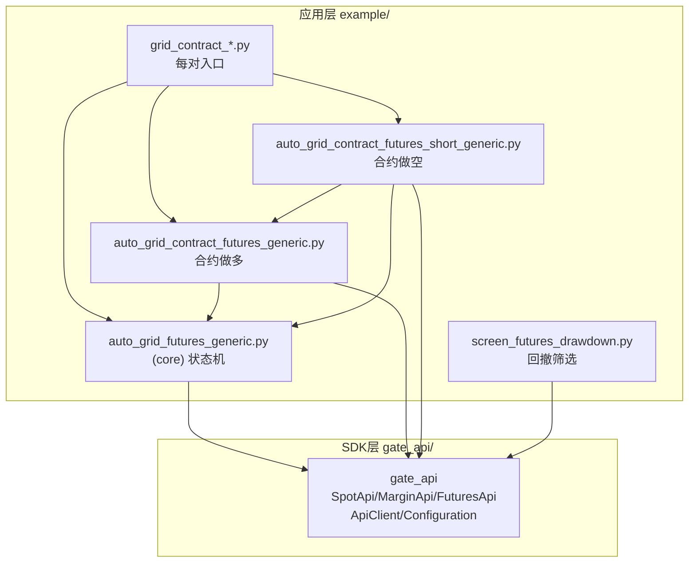
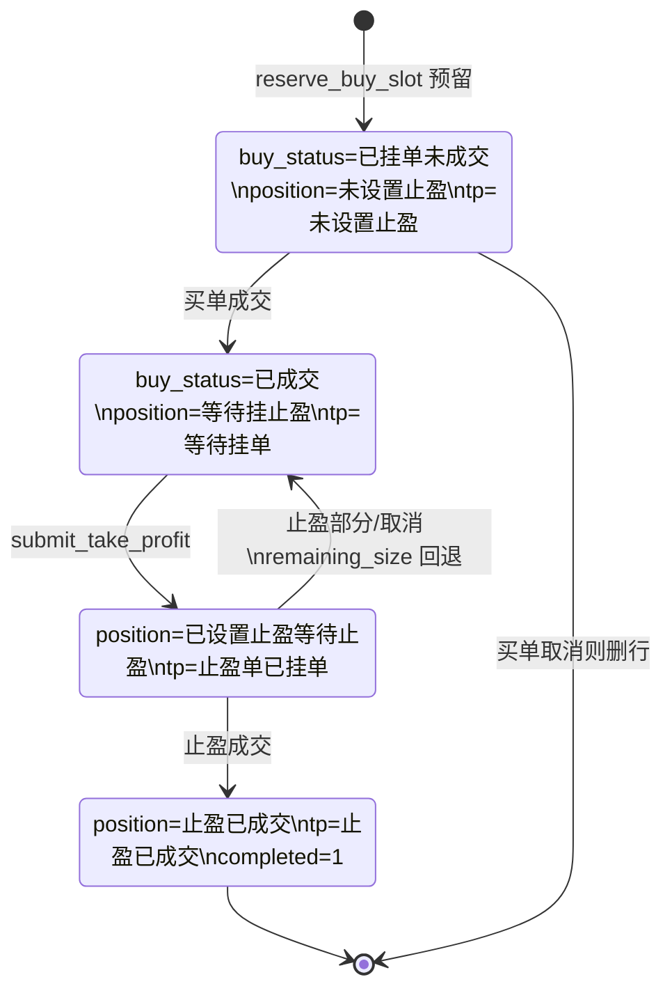
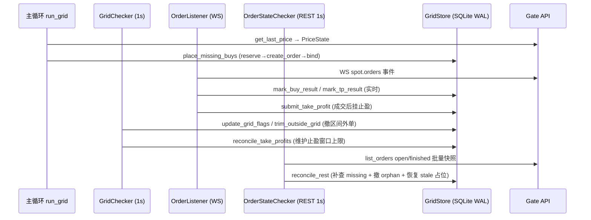

<!--
更新时间：2026-08-23T15:24:00+08:00
Git 提交：0c2c73bf7c67184a5df5131ebb37b99bfd4b0b9a
-->

# gateapi-python 项目知识文档

> 本文档由 `project-knowledge-analyzer` 基于当前工作区源码、配置、测试与构建脚本生成。所有结论以当前代码为准，关键结论附可导航的相对路径与符号名。

## 1. 版本与分析范围

- **Git 基准**：`master` 分支，HEAD = `0c2c73bf7c67184a5df5131ebb37b99bfd4b0b9a`。
- **工作树状态**：包含未提交更改。`git diff --stat` 显示 1532 个已跟踪文件出现“等量增删”（约 839k 行 insertions = 839k 行 deletions），这是 **CRLF↔LF 行尾差异**导致的整文件重写，并非业务逻辑变更。此外，自上次分析以来，新增并持续扩展了一组**全新的非 CLI 工具库 `tools/`、其测试与前端**：`tools/__init__.py`（已暂存，`AM`，仅重导出）、`tools/market_candlesticks.py`、`tools/rank_futures_yearly_gain.py`、`tools/api_server.py`（FastAPI 服务）、`tools/web/`（Vue3 静态前端）、`tests/test_market_candlesticks.py`（33 用例）、`tests/test_rank_futures_yearly_gain.py`（17 用例）、`tests/test_api_server.py`（16 用例，本次新增）；连同既有的 `example/screen_futures_drawdown.py`、`tests/test_screen_futures_drawdown.py`、`run_server.bat`、`tools/执行计划-一年K线查询与合约涨幅排行.md`。
- **分析包含未提交更改**：本文档以当前工作树内容（含上述行尾差异与新增文件）为准，记录的代码现状对应 HEAD 之上叠加的未提交状态。
- **本次实际验证**：执行了只读命令（`git`、`ls`、`grep`、`cat`、`read`）以及 `pytest tests/`（Windows venv `.venv/Scripts/python.exe`），结果 **134 passed, 1 warning**；此外通过临时启动 `tools.api_server:app` 并用 raw socket 请求真实 Gate API 的 `/api/rank?limit=50`，约 42.7 秒返回 50 条结果。未执行构建，未修改业务数据。
- **已确认 / 高概率判断 / 无法确认** 的区分见各节行文与第 18 节。

## 2. 项目概述与技术栈

### 2.1 项目性质（已确认）

本项目是 **Gate.io 官方 Python SDK（`gate_api` 包）** 与 **一套手写网格交易应用** 的混合仓库：

1. **SDK 层 `gate_api/`**：由 [OpenAPI Generator](https://openapi-generator.tech) 自动生成，版本 `7.2.123`（对应 Gate REST API v4.106.123）。`setup.py` 与 `README.md` 明确声明 `Generated by: https://openapi-generator.tech`。这是对外发布到 PyPI 的库（包名 `gate-api`，`setup.py`）。
2. **应用层 `example/`**：原为 SDK 使用示例，但已被深度扩展为一套**真实运行的 SQLite 持久化网格交易机器人**，含独立的数据库状态机、WebSocket 监听、REST 对账、进程锁与多进程部署脚本。这是本仓库实际被持续开发与定制的部分。
3. **辅助工具 `scripts/`、`tools/`**：`scripts/` 为股票/ETF 振幅排行离线工具（CLI）；`tools/` 为**非 CLI 的纯函数工具库**（一年 K 线抓取、合约年度低位涨幅排行），可注入 fake API 独立测试。`tools/执行计划-一年K线查询与合约涨幅排行.md` 是规划 `tools/` 包的开发文档。

> 判断依据：`example/README.md`（手写中文说明）与 `example/auto_grid_futures_generic.py`（约 2175 行、含 `GridStore`/`OrderListener`/`GridChecker`/`run_grid` 等完整实现）证明 `example/` 已远超“示例”，是真实业务逻辑。`gate_api/__init__.py`、`gate_api/api_client.py`、`gate_api/rest.py` 的生成式风格证明 SDK 为自动生成。

### 2.2 技术栈（已确认）

| 维度 | 内容 | 证据 |
|------|------|------|
| 语言 | Python（`setup.cfg` 仍声明支持 2.7 / 3.x；但 `example/` 大量使用 `from __future__ import annotations`、`dataclass`、`list[...]` 泛型标注、`f-string`，实际仅支持 Python 3.7+） | `setup.cfg`、`example/auto_grid_futures_generic.py` |
| SDK 依赖 | urllib3、six、certifi、python-dateutil、websocket-client(≥1.8.0) | `setup.py` REQUIRES、`requirements.txt` |
| 测试 | pytest（`test-requirements.txt` 声明 `pytest~=4.6.7`，但实际测试用 `unittest.TestCase` 与裸 `def test_`） | `test-requirements.txt`、`tests/*.py` |
| 持久化 | SQLite（标准库 `sqlite3`，WAL 模式） | `example/auto_grid_futures_generic.py` `GridStore` |
| WebSocket | `websocket-client`（同步 `create_connection`） | `example/auto_grid_futures_generic.py` `OrderListener.run` |
| 外部数据 | CoinGecko `/coins/markets`（`screen_futures_drawdown.py`）、Gate CFD/Stock API（`scripts/`） | `example/screen_futures_drawdown.py`、`scripts/rank_stock_etf_amplitude.py` |
| 构建打包 | `setuptools`（`setup.py sdist bdist_wheel`） | `setup.py`、`.github/workflows/python-publish.yml` |
| CI | GitHub Actions（tag 触发 PyPI 发布）、GitLab CI（多版本 pytest）、Travis（多版本 pytest） | `.github/workflows/`、`.gitlab-ci.yml`、`.travis.yml` |
| 部署 | Linux systemd 单元 + `scp` 分发到远端主机 | `example/script/gate-grid-skhynix.service`、`cp.txt` |

## 3. 总体架构与目录

### 3.1 顶层目录职责

```
gateapi-python/
├── gate_api/            # [SDK] 自动生成的 Gate API v4 Python 客户端（发布到 PyPI）
│   ├── __init__.py      # 导出 28 个 *Api 类 + 721 个 Model + ApiClient/Configuration/异常
│   ├── api/             # 28 个 *Api.py（account/spot/margin/futures/delivery/options/...）
│   ├── models/          # 721 个数据模型 *.py
│   ├── api_client.py    # 请求序列化/反序列化、鉴权、重试、异步请求封装
│   ├── configuration.py # host/key/secret/proxy/超时等全局配置
│   ├── exceptions.py    # OpenApiException 体系（GateApiException 含 label/message/status）
│   └── rest.py          # urllib3 REST 传输层
├── example/             # [应用] 网格交易机器人 + 原 SDK 示例
│   ├── auto_grid_futures_generic.py        # [核心] 逐仓杠杆现货 SQLite 网格状态机（“core”）
│   ├── auto_grid_contract_futures_generic.py   # 合约做多网格（复用 core，适配 FuturesApi）
│   ├── auto_grid_contract_futures_short_generic.py  # 合约做空网格（复用 core，方向反转）
│   ├── grid_contract_*.py / grid_contract_short_*.py  # 每个交易对的薄入口（调 run_grid/run_short_grid）
│   ├── screen_futures_drawdown.py          # 永续合约 6 个月回撤筛选（未跟踪新文件）
│   ├── app.py / config.py / futures.py / margin.py / spot.py / p2p_merchant_api.py  # 原 SDK 示例
│   ├── *.sqlite3[-wal/-shm]               # 运行时网格状态库（已 gitignore）
│   ├── .env                               # API 凭证（已 gitignore）
│   ├── script/*.service                   # systemd 单元模板
│   └── build.sh                           # 原示例的 venv 安装脚本
├── tests/               # 应用层测试（pytest 发现，unittest + 函数式；6 文件 108 用例）
├── scripts/             # 股票/ETF 振幅排行离线工具（CLI）
├── tools/               # [工具库] 非 CLI 纯函数：K线抓取 / 合约年度涨幅排行 + 执行计划文档
│   ├── __init__.py                # 重导出公共入口（from tools import ...，导入无副作用）
│   ├── market_candlesticks.py     # 任意周期 K线抓取（spot/futures，分页+去重+3h合成+10000点天花板）
│   ├── rank_futures_yearly_gain.py # 全市场合约年度低位涨幅排行（并发）
│   ├── api_server.py              # FastAPI 服务（K线/排行/合约列表 + Vue3 静态前端）
│   └── web/                       # Vue3 前端（无构建步骤：ESM + canvas 自绘 K 线图）
│   └── 执行计划-一年K线查询与合约涨幅排行.md  # 开发规划文档
├── docs/                # [SDK] 748 个自动生成的 API 文档 *.md
├── setup.py / setup.cfg / requirements.txt / test-requirements.txt / tox.ini
└── .github/workflows/ .gitlab-ci.yml .travis.yml  # CI
```

### 3.2 依赖方向（已确认）



关键约定：`auto_grid_contract_futures_generic.py` 与 `_short_generic.py` 顶部均 `from . import auto_grid_futures_generic as core`（带 `try/except ImportError` 兼容直接运行），把核心状态机 `core` 作为方向无关基础设施复用；合约层只替换交易接口与价格方向计算。**应用层单向依赖 SDK 层，SDK 层不反向引用应用层。**

## 4. 启动流程

### 4.1 SDK 入口

SDK 无可执行入口；作为库被 `import gate_api` 使用。`gate_api/__init__.py` 在导入时即 eager 导入全部 28 个 `*Api` 与 721 个 Model（`from gate_api.api.spot_api import SpotApi` 等），因此 `import gate_api` 即获得全部公共符号。

### 4.2 应用入口：逐仓现货网格（`core.run_grid`）

实文件 `example/auto_grid_futures_generic.py` 末尾 `if __name__ == "__main__": run_SOXLG()`。`run_SOXLG()` → `run_grid(...)`。启动链（已确认，按 `run_grid` 函数体顺序）：

1. **参数校验**：`startup_mode ∈ {resume,reset}`、各计数 > 0、`poll_interval ≥ 0.5`、订单前缀 ASCII 字母数字且 ≤ 4 字符、`step_pct/tp_pct < 1`。
2. **加载环境**：`load_env_file()` 依次读 `example/.env`、项目根 `.env`，用 `os.environ.setdefault` 注入（**已存在的环境变量优先于 .env**）。
3. **解析 host/live**：`GATE_HOST`（默认 `https://api.gateio.ws/api/v4`）、`GATE_WS_URL`（默认 `wss://api.gateio.ws/ws/v4/`）、`GATE_LIVE_CONFIRM == LIVE_CONFIRM_TEXT`（`RUN_REAL_MARGIN_DB_GRID`）判定是否实盘。
4. **安全预览（非实盘）**：用公开 `ApiClient`（无凭证）读交易对规格与最新价，打印计划买单后 **直接 return**，不触碰私有接口。
5. **实盘初始化**：`required_env` 取 `GATE_API_KEY`/`GATE_API_SECRET`；创建 **4 个独立 `ApiClient`**（main/checker/listener/state，各持独立连接池）；`StrategyProcessLock` 抢占 `<db>.<pair>.lock` 文件锁（Windows `msvcrt.locking` / POSIX `fcntl.flock`）；打开 `GridStore`（建表/迁移）。
6. **策略码**：`strategy_code(...)` = `sha256(grid_tag|db-margin|pair|ref|step|tp|margin|leverage[|max-unclosed])[:8]`，作为该套参数的唯一标识，用于隔离同库不同策略。
7. **启动 3 个守护线程**：`GridChecker`（维护网格窗口）、`OrderListener`（WebSocket 推进成交）、`OrderStateChecker`（REST 每秒对账）。
8. **主循环**：每 `poll_interval` 秒读价、`place_missing_buys` 补现价下方买格、打印状态摘要；连续 5 轮失败抛 `RuntimeError` 自停；`KeyboardInterrupt` 仅置 `stop`，**不撤现有挂单**。
9. **关闭**：`stop.set()` → join 三线程（带超时）→ 关闭 client/store/释放锁；若线程仍在退出则暂不关其 client。

> 合约做多/做空入口 `run_grid`/`run_short_grid` 结构同构：4 个 `FuturesApi` 客户端、`configure_futures_account` 设置杠杆与持仓模式、`resume` 时 `resume_short_strategy_code` 优先沿用库中已有策略码（**resume 不严格校对启动参数**，与现货版不同）。

## 5. 核心模块与业务流程：网格交易状态机

这是本仓库的真正核心。`example/auto_grid_futures_generic.py`（下称 `core`）实现了一个**方向无关的 SQLite 持久化网格状态机**；合约层通过适配器复用。

### 5.1 核心抽象

| 符号 | 文件 | 职责 |
|------|------|------|
| `GridStore` | `core` | 线程安全（`threading.RLock`）SQLite 存储，WAL 模式，单表 `grid_cycles` |
| `OrderListener` | `core` | 订阅 `spot.orders` WebSocket，实时推进成交；断线自动重连 |
| `OrderStateChecker` | `core` | 唯一 REST 对账线程，每 `ORDER_STATE_CHECK_INTERVAL`(1s) 把 Gate 实际状态同步入库 |
| `GridChecker` | `core` | 维护现价上下方网格窗口，撤销区间外挂单，调度止盈维护 |
| `StrategyProcessLock` | `core` | 跨进程文件锁，阻止同库同对双进程 |
| `PriceState` | `core` | 带锁的最新价共享容器 |
| `FuturesGridApi` / `ShortFuturesGridApi` | 合约层 | 适配器：把 `FuturesApi` 映射为 `core` 期望的最小订单接口 |

### 5.2 数据模型：`grid_cycles` 表（已确认）

`GridStore.__init__` 用 `CREATE TABLE IF NOT EXISTS` 建表并执行**向前兼容迁移**（`PRAGMA table_info` 检测列、`UPDATE` 修复旧版状态文本）。核心列：

- 标识：`id`, `currency_pair`, `strategy_code`
- 买腿：`buy_price`, `buy_size`, `remaining_size`, `buy_order_id`, `buy_order_text`, `buy_status`
- 止盈腿：`tp_price`, `tp_order_id`, `tp_order_text`, `tp_status`, `position_status`
- 控制：`in_grid`, `completed`, `last_checked_at`, `created_at`, `updated_at`

索引：`idx_grid_pair_state`、`idx_grid_buy_price`、`idx_grid_order_ids`、`idx_grid_pending`。

### 5.3 周期状态机（已确认）

一条 `grid_cycles` 记录 = 一个完整周期（买单 → 止盈卖单）。状态文本为中文常量（`core` 顶部 `BUY_OPEN`/`BUY_FILLED`/`POSITION_*`/`TP_*`）。`example/README.md` 给出的目标序列：



关键安全设计（已确认）：
- **买单未成交时只保存计划止盈价 `tp_price`，不挂卖单**，避免卖单自动借入基础币形成意外空头（`core` 文件头注释）。
- **下单前原子占位** `reserve_buy_slot`：`BEGIN IMMEDIATE` 事务内 `COUNT` 同价位活动数，达 `max_unclosed_per_grid` 上限则回滚返回 `None`，保证不会超挂。
- **止盈挂单抢占** `claim_take_profit`：用条件 `UPDATE ... WHERE tp_status IN (...)` 防止 WebSocket 线程与检查器重复下单；`set_take_profit_open` 处理监听器抢先绑定的幂等情况。
- **碎片处理 `TP_DUST`**：止盈剩余低于交易对最小下单量时转为碎片行保留审计，不再无限重挂。

### 5.4 三线程协作模型（已确认）



- **WebSocket 实时推进**为主，**REST 每秒对账**为兜底（断线恢复 + 防丢事件）。`reconcile_rest` 还会 `recover_stale_take_profit_claims` / `recover_stale_buy_reservations` 清理超时占位（`TP_SUBMISSION_STALE_SECONDS=60`、`BUY_RESERVATION_STALE_SECONDS=60`）。
- **孤单清理** `cancel_orphan_take_profits`：撤销属于本策略但无已成交买单关联的卖单，带 `ORPHAN_ORDER_GRACE_SECONDS=15` 创建宽限期。
- 三线程共享同一个 `GridStore`（`RLock` 串行化）与 `PriceState`。

### 5.5 网格价格与窗口计算（已确认）

- 锚定网格价：`buy_grid_price = reference * (1 - step_pct)^index`，向 `price_step` 取整。
- `first_buy_index`：用对数定位现价下方第一个买格，再做线性修正。
- 买窗：现价下方最近 `buy_grid_count` 个锚定价。
- 止盈窗上界：`take_profit_window_upper` = 现价上方第 `take_profit_grid_count` 个锚定价；`reconcile_take_profits` 只保留落在 `(current, upper]` 内、且最接近现价的 `take_profit_count` 个止盈，远端撤销。
- 合约做多复用上述；**做空版反转**：网格价 `reference*(1+step)^index` 向上排列，开空为 SELL（负张数、`reduce_only=False`），平仓为 BUY（正张数、`reduce_only=True`），止盈窗为现价下方 `[lower, current)`。

## 6. SDK 层：`gate_api` 包

### 6.1 公共 API 表面（已确认）

`gate_api/__init__.py` 导出 28 个 `*Api` 类，覆盖：`AccountApi`、`SpotApi`、`MarginApi`、`MarginUniApi`、`FuturesApi`、`DeliveryApi`、`OptionsApi`、`CFDApi`、`StockApi`、`EarnApi`、`EarnUniApi`、`UnifiedApi`、`WalletApi`、`WithdrawalApi`、`SubAccountApi`、`P2pApi`、`OtcApi`、`RebateApi`、`CouponApi`、`WelfareApi`、`FlashSwapApi`、`MultiCollateralLoanApi`、`AssetswapApi`、`BotApi`、`ActivityApi`、`SquareApi`、`AlphaApi`、`CrossExApi`。同时导出 `ApiClient`、`Configuration`、异常体系（`OpenApiException`/`ApiException`/`GateApiException` 等）与 721 个 Model。

应用层实际使用的 SDK 入口有限：`ApiClient`、`Configuration`、`SpotApi`、`MarginApi`、`FuturesApi`、`Order`、`FuturesOrder`、`MarginMarketLeverage`，以及 `gate_api.exceptions.{ApiException, GateApiException}`。

### 6.2 鉴权与请求（已确认）

`gate_api/configuration.py` 持有 `host/key/secret/proxy`；`gate_api/api_client.py` 负责请求构建、签名（Gate v4 HMAC SHA512）、序列化与异步请求（`async_req=True` 返回可 `.get()` 的 job）。`gate_api/rest.py` 封装 urllib3 `PoolManager`。

应用层在 `core.make_configuration` 中显式设 `configuration.retries = False`（关闭 SDK 内置重试，改由 `core.call_with_retry` 自行控制可重试异常：`HTTPError` 及 `ApiException` 的 429/500/502/503/504）。

## 7. 接口与业务层

### 7.1 无 HTTP/CLI 业务层（已确认）

本项目**不是 Web 服务**，无 Controller/Service/Repository 分层。业务入口为 Python 函数：

- **现货逐仓网格**：`example/auto_grid_futures_generic.py::run_grid` / `run_SOXLG`
- **合约做多网格**：`example/auto_grid_contract_futures_generic.py::run_grid` / `run_SOXL`
- **合约做空网格**：`example/auto_grid_contract_futures_short_generic.py::run_short_grid` / `run_SOXL`
- **回撤筛选**：`example/screen_futures_drawdown.py::main`（argparse CLI）
- **一年 K 线抓取（库函数）**：`tools.market_candlesticks::get_one_year_hourly_candlesticks`（非 CLI）
- **合约年度低位涨幅排行（库函数）**：`tools.rank_futures_yearly_gain::rank_futures_by_yearly_low_gain`（非 CLI）
- **振幅排行**：`scripts/rank_stock_etf_amplitude.py`、`scripts/show_top100.py`、`scripts/verify_top100.py`
- **原 SDK 示例 CLI**：`example/app.py`（`argparse`，子命令 `spot/margin/futures/p2p_merchant`）

### 7.2 适配器模式（已确认，重要）

合约层用**适配器模式**把 `FuturesApi` 适配到 `core` 期望的现货式最小订单接口：

- `FuturesGridApi._normalise(order)`：把合约订单（`size` 带符号、`contract` 字段、`status=finished+finish_as`）归一化为 `SimpleNamespace`（`amount`/`left`/`filled_amount`/`currency_pair`/`status∈{open,closed,cancelled}`）。
- `FuturesGridApi.create_order`：按 `side` 把现货式 `amount` 转成带符号合约 `size`（买正卖负），构造 `FuturesOrder`（`tif="gtc"`、卖出 `reduce_only=True`）。
- `ShortFuturesGridApi` 进一步反转：开空=SELL、平仓=BUY，`reduce_only` 语义对调。
- `_MappedJob` 包装异步请求结果，统一走 `_normalise`。

这使 `core` 的 `GridStore`/`GridChecker`/`OrderListener`/`mark_*_result` 等方向无关逻辑可被三套网格共用。

## 8. 数据、状态与异步机制

### 8.1 持久化与事务（已确认）

- **SQLite + WAL**：`GridStore` 开 `PRAGMA journal_mode=WAL`、`busy_timeout=5000`，单连接 `check_same_thread=False` + `RLock` 串行化。
- **关键写操作用 `BEGIN IMMEDIATE` 显式事务**：`reserve_buy_slot`（占位）、`bind_reserved_buy`、`claim_take_profit`、`set_take_profit_open`、`attach_missing_take_profit` 均在事务内条件更新，失败回滚。
- **多库隔离**：现货 `grid_orders.sqlite3`、合约做多 `futures_grid_orders.sqlite3`、合约做空 `futures_short_grid_orders.sqlite3`，互不读取（`example/README.md` 明确）。
- **进程锁粒度**：`<db>.<pair>.lock`（现货）/ `<db>.<settle>.<contract>.lock`（合约），文件锁防止同对多进程。

### 8.2 异步与并发（已确认）

- **多线程**：每实例 3 守护线程（`GridChecker`/`OrderListener`/`OrderStateChecker`）+ 1 主循环，共享 `GridStore`（`RLock`）与 `PriceState`（`Lock`）。
- **4 个独立 `ApiClient`**：main/checker/listener/state 各自独立，避免连接池争用。
- **WebSocket 同步阻塞 + 自重连**：`OrderListener.run` 用 `websocket.create_connection`，`ws.settimeout(1)` 非阻塞轮询，20s 发 ping，异常后 `WEBSOCKET_RECONNECT_INTERVAL`(2s) 重连。
- **异步请求**：`list_order_snapshot` 用 `async_req=True` 并发拉 open/finished 快照。
- **无 async/await**：全项目基于线程，未使用 `asyncio`。
- **取消语义**：`stop.set()` + `thread.join(timeout)`；停止**不撤挂单**（设计意图：下次 `resume` 继续）。

### 8.3 状态恢复（已确认）

- `resume`：从库中已有策略恢复；现货版检测 `unfinished_other_strategies` 冲突即拒；合约做空版 `resume_short_strategy_code` 优先沿用库中策略码，**不严格校对启动参数**（代码注释明确）。
- `reset`：撤销该对未成交订单（`cancel_api_order(ignore_absent=True)` 容忍已关闭/不存在），`clear_pair` 清行后重建。
- **崩溃恢复**：`reconcile_rest` 补建未入库的买单/止盈单（`insert_buy`/`attach_missing_take_profit` 幂等）、补查 missing 订单、清理 stale 占位。

## 9. 配置、日志、异常、并发公共机制

### 9.1 配置优先级（已确认）

`GATE_*` 环境变量，来源优先级：**shell 环境变量 > `example/.env` > 项目根 `.env`**（`load_env_file` 用 `os.environ.setdefault`，已存在的不覆盖）。关键变量：

| 变量 | 作用 | 默认 |
|------|------|------|
| `GATE_API_KEY` / `GATE_API_SECRET` | 实盘凭证（`required_env`） | 必填 |
| `GATE_USER_ID` | 合约网格需要（做空版 `required_env`） | 合约必填 |
| `GATE_LIVE_CONFIRM` | 实盘确认值，须精确等于各 `LIVE_CONFIRM_TEXT` | 空=预览 |
| `GATE_HOST` | REST host | `https://api.gateio.ws/api/v4` |
| `GATE_WS_URL` | WebSocket URL | `wss://api.gateio.ws/ws/v4/`（合约版 `wss://fx-ws.gateio.ws/v4/ws/usdt`） |
| `GATE_PROXY` | HTTP 代理（REST + WebSocket） | 无 |

实盘确认值（互不相同，防误触）：现货 `RUN_REAL_MARGIN_DB_GRID`、合约做多 `RUN_REAL_FUTURES_DB_GRID`、合约做空 `RUN_REAL_FUTURES_SHORT_DB_GRID`。

> ⚠️ `example/.env` 当前**含真实 API 凭证且未被 gitignore 完全覆盖**（`.gitignore` 有 `/example/.env`，但工作树中文件存在）。本文档不转录凭证。

### 9.2 日志（已确认）

**无统一 logging 框架**，应用层（`example/`）统一 `print(f"[{now_text()}] ...")` 到 stdout。`now_text()` = `datetime.now().strftime("%Y-%m-%d %H:%M:%S")`。`example/app.py` 用 `logging.basicConfig(level=DEBUG)`，但网格应用未用。systemd 单元设 `Environment=PYTHONUNBUFFERED=1` + `python3 -u` 保证日志即时输出，`journalctl -u <service>` 查看（见 `cp.txt`）。

**例外**：`tools/api_server.py` 使用标准库 `logging` 创建专用 `tools.api_server` logger（`StreamHandler`、`INFO` 级别、`propagate=False`），用于输出 `/api/rank` 与 `/api/rank/jobs` 的生命周期日志（`rank start`、`rank progress`、`rank done`、错误堆栈），以便在 uvicorn 默认日志配置下仍能看到排行进度。

### 9.3 异常处理（已确认）

- `GateApiException`（SDK）带 `label`/`message`/`status`，是可恢复判断的核心。`retryable()` 把 429/5xx 标记可重试。
- 特定 label 分支处理：`BALANCE_NOT_ENOUGH`/`AUTO_BORROW_TOO_MUCH` 暂停补单并设 `balance_cooldown_until`（`BALANCE_RETRY_INTERVAL=30s`）；`ORDER_NOT_FOUND`/`ORDER_CLOSED`/`ORDER_CANCELLED` 在 reset 时忽略；`INVALID_PARAM_VALUE`+"too small" 转碎片。
- 主循环连续 5 轮失败抛 `RuntimeError` 自停；线程内异常被捕获打印，不向上传播（保证线程存活）。
- 统一错误格式化：`f"label={exc.label}, message={exc.message}" if isinstance(exc, GateApiException) else str(exc)`。

### 9.4 Decimal 精度（已确认，重要约定）

全应用层用 `decimal.Decimal` 处理价格/数量，**绝不浮点**。工具函数：`decimal_value`（校验有限正数）、`decimal_text`（去尾零）、`round_to_step`（按步长取整，买价 `ROUND_HALF_UP`、止盈价 `ROUND_UP`、数量 `ROUND_DOWN`）。SDK 返回的字符串经 `Decimal(str(...))` 转换。

## 10. 辅助工具

### 10.1 回撤筛选 `example/screen_futures_drawdown.py`（未跟踪新文件）

argparse CLI，扫描 Gate 永续合约 6 个月（183 天）4h K 线回撤。`screen_contracts` 逻辑：列出非下架合约 → 按 `base_currency` 经 `CoinGeckoMarketCaps.get_many` 取 USD 市值 → 过滤市值区间（默认 8M–100M）→ 算 `(peak-last)/peak` → 回撤 > 阈值（默认 70%）→ 按回撤降序取 top N。`CoinGeckoMarketCaps` 设计为可替换接口（便于换付费数据源），支持 `--coin-id-overrides` 解决符号碰撞。

### 10.2 振幅排行 `scripts/`

`rank_stock_etf_amplitude.py`：取 Gate CFD `/tradfi/symbols`(category_id=2) 与 `StockApi` 现货符号，拉 96 根 15m K 线（24h），滑窗 10 根算平均振幅取**最小值**作为比较值，降序排行 top100。单 HTTPS keep-alive 连接、~4 qps（低于 Gate 5 qps 限制），输出 CSV+JSON。产物 `top100_stock_etf_15m_amplitude.{csv,json}`、`all_stock_etf_15m_amplitude.json` 已入库。

### 10.3 一年 K 线工具库 `tools/`（未跟踪新包，非 CLI）

`tools/` 是**非 CLI 的纯函数工具库**，通过 `tools/__init__.py` 重导出公共入口（`from tools import get_candlesticks, get_one_year_hourly_candlesticks, rank_futures_by_yearly_low_gain, VALID_INTERVALS, INTERVAL_SECONDS, MAX_LOOKBACK_POINTS`）。**导入包无副作用**：`gate_api` SDK 在默认客户端工厂内**惰性导入**，调用方注入自己的 fake/真实 API 则完全不触达 `gate_api`。设计要点（已确认，来自源码）：

- **`tools/market_candlesticks.py`**：
  - **主入口** `get_candlesticks(market_type, trading_pair, interval="1h", span_days=365, settle="usdt", end_time=None, spot_api=None, futures_api=None, request_timeout=30, max_retries=3)` —— 抓取任意周期的 K 线并归一化为统一 dict（`{timestamp, open, high, low, close, volume}`，价格为 decimal 字符串）。`get_one_year_hourly_candlesticks(...)` 现为向后兼容包装器，等价于 `get_candlesticks(interval="1h", span_days=365)`。
  - **支持周期** `VALID_INTERVALS = {1h,2h,3h,4h,6h,8h,12h,1d,2d,3d,7d,30d}`，`INTERVAL_SECONDS` 映射到秒数。`3h` 非 Gate 原生支持，由 `_aggregate_candles` 聚合 3 根 `1h` 合成（open=首、close=末、high=max、low=min、volume=sum，丢弃不完整尾组）。
  - **10000 点历史天花板**：Gate 仅返回最近约 10000 根 K 线，超过则 400 报错。`MAX_LOOKBACK_POINTS=9950`（50 根安全余量）。`_validate_history_ceiling` 在请求前预校验窗口起点 `>= now - 9950*iv_sec`，超过则抛 `ValueError`。对 `1h`≈414 天，对 `1d`+ 则合约上线日才是实际下限。
  - Gate 单请求上限 spot=999 点 / futures=1999 点（含端点），按 `interval_seconds` 分页（`_page_windows`），跨页按时间戳去重合并，按 `timestamp` 升序。
  - `end_time` 向下对齐到**周期边界**（`_align_to_interval_boundary`，排除进行中周期），保证重复调用结果稳定。
  - spot 原始数组序 `[t, v, c, h, l, o, sum]` 与 futures `FuturesCandlestick`（`t/v/c/h/l/o`，**`t` 为 float**）形状不同，分别经 `_normalize_spot_candle` / `_normalize_futures_candle` 桥接。
  - 重试：`_call_with_retry` 对瞬时错误（HTTPError/ConnectionError/Timeout 类、`ApiException.status∈{429,500,502,503,504}`、含 "rate" 的 `GateApiException.label`）指数退避重试，默认 `max_retries=3`、`base_backoff=0.5s`。
  - 默认客户端：`config.retries=False`（关闭 SDK 内置重试，与 `core` 一致），**自有客户端成功/失败都关闭，注入的客户端永不关闭**。

- **`tools/rank_futures_yearly_gain.py`**：`rank_futures_by_yearly_low_gain(settle="usdt", end_time=None, futures_api=None, max_workers=4, ..., limit=None)` 扫描某结算币下在交易、未下架合约，逐项抓一年 K 线，按 `gain_pct=(current_price - year_low)/year_low*100` 排名，返回 `{"results": [...], "errors": [...], "stats": {...}}`。`limit` 指定时按 `trade_size` 取最活跃的 N 个合约做快速预览。
  - 当前价优先 `Contract.last_price`，缺失/无效时回退最近一根 K 线 `close`，来源记录在 `current_price_source`（`contract_last_price`/`latest_candle_close`）。
  - `Decimal` 计算；`year_low_time` 取最低点首次出现的时间戳（重复时稳定）。
  - 单合约失败隔离进 `errors` 不中断整盘；但**合约列表请求失败则直接抛出**（避免空结果伪装成完整扫描）。
  - 并发由可注入 `max_workers` 限定（默认 4）的 `ThreadPoolExecutor` 控制；`max_workers<=1` 走串行保证确定性；结果始终在调用线程排序（`gain_pct` 降序、名称升序）。可选 `progress_callback(completed,total,contract,error)`。
  - `_is_active_contract`：`in_delisting=False` 且 `status`（缺失/空视为活跃）为 `trading`。

### 10.4 FastAPI 服务与 Vue3 前端 `tools/api_server.py` + `tools/web/`（未跟踪新文件）

- **`tools/api_server.py`**：基于 FastAPI 的 HTTP 服务，通过 `create_app()` 工厂构造应用（`tools/api_server.py::create_app`），模块末尾 `app = create_app()`。把 `tools` 的同步函数用 `starlette.concurrency.run_in_threadpool` 卸载到工作线程，避免阻塞 ASGI 事件循环。**无需 API key**，全部使用 Gate 公开行情端点。路由：
  - `GET /api/valid_intervals` —— 返回支持周期列表 + 各周期最大可回看天数/默认天数。
  - `GET /api/candles?market_type=&trading_pair=&interval=&span_days=&settle=&end_time=` —— OHLCV K 线；`ValueError`（如回看超 10000 点天花板）→ 400，其他异常 → 500。
  - `GET /api/rank?settle=&max_workers=&limit=` —— **同步**永续合约年度低位涨幅排行。默认扫描全部 ~900+ 合约（需 30s–5min）；传 `limit=N` 只扫交易量前 N 快速预览。`stats` 含 `total_contracts`/`requested_contracts`/`successful_contracts`/`failed_contracts`/`elapsed_seconds`。后端使用专用 `tools.api_server` logger（`StreamHandler`，`INFO` 级别，`propagate=False`），输出 `rank start`、`rank progress`、`rank done` 等生命周期日志。
  - `POST /api/rank/jobs?settle=&max_workers=&end_time=&limit=`（**202**）—— **异步后台排行任务**：启动一个守护 `threading.Thread` 跑 `rank_futures_by_yearly_low_gain`（可选 `progress_callback` 更新进度），返回可轮询 job 快照（`status∈{queued,running,completed,failed}`、`progress{completed,total,successful,failed,percent,current_contract}`、`report`）。任务集合由 `rank_jobs_lock` 保护，容量超 20 时按完成时间淘汰最旧的 completed/failed job。`GET /api/rank/jobs/{job_id}` —— 轮询指定后台任务进度/结果（未知 id → 404）。此设计把长扫描移出请求/响应生命周期，前端轮询避免单次 HTTP 超时。
  - `GET /api/contracts?settle=` —— 列出活跃永续合约（`in_delisting=False` 且 `status=="trading"`，仅 name + last_price）。
  - `GET /` —— Vue3 SPA 前端；静态资源在 `/static` 挂载点（`StaticFiles(directory=tools/web)`），`/` 返回 `index.html`，其余非 `/api`、非 `/static` 路径走 SPA fallback 回 `index.html`。无 npm 构建步骤。
  - 开启宽松 CORS（`allow_origins=["*"]`）以便 Vite 开发服务器跨域调用。
- **`tools/web/`**：无构建步骤的 Vue3 前端（通过本地 ESM `vue.esm-browser.prod.js` + 自绘 canvas K 线图 `chart.js`，无重型图表库依赖）：
  - `index.html` / `main.js` / `styles.css` / `chart.js` / `vue.esm-browser.prod.js`。
  - **K线图 Tab**：顶部工具栏添加交易对（市场/对/周期/天数/结算币），网格布局每个交易对一个卡片，含 canvas K 线图 + OHLCV 统计（开收高低/涨跌幅/时间范围），支持多交易对同时展示、随时刷新/移除。
  - **合约涨幅排行 Tab**：默认 `scanLimit=50`（最活跃前 50 快速预览）。点击「刷新排行」后，前端调用 `POST /api/rank/jobs?max_workers=6&limit=50` 启动后台任务，随后每 500ms 轮询 `GET /api/rank/jobs/{job_id}` 显示实时进度（`progress.completed / total`）。表格按 `gain_pct` 降序、可按名称筛选，每行可一键「+ 添加」到 K 线图 Tab。
  - **前端调试与容错**：`main.js` 顶部注册全局 `window.addEventListener('error' / 'unhandledrejection')`，`apiGet`/`apiPost` 支持 `timeoutMs` 参数（通过 `AbortController`）并在超时/网络/HTTP 错误时抛出中文提示；`RankView` 仅在 `active` prop 为真时加载，具备加载/空状态/错误提示；setup、mounted、load、filtered 等关键路径输出 `[App]`/`[apiGet]`/`[RankView]` 等 `console.log` 标记。
- **`run_server.bat`**：Windows 批处理启动器（默认 `0.0.0.0:8787`）。

`tools/执行计划-一年K线查询与合约涨幅排行.md`（未跟踪）记录了本包的需求与开发规划。

## 11. 测试

### 11.1 测试组织（已确认）

`tests/` 下 7 个文件（134 用例），pytest 发现，混用 `unittest.TestCase` 与函数式 `def test_`：

| 文件 | 测试数 | 覆盖 |
|------|--------|------|
| `test_auto_grid_futures_generic.py` | 48 | `GridStore` CRUD/迁移、`strategy_code`、`reserve_buy_slot`/`claim_take_profit` 抢占、`mark_buy_result`/`mark_tp_result`、孤儿清理等核心状态机 |
| `test_auto_grid_contract_futures_generic.py` | 11 | `FuturesGridApi` 适配器：`_normalise`、买正卖负 `size`/`reduce_only`、订单列表过滤、`calculate_contract_size` |
| `test_auto_grid_contract_futures_short_generic.py` | 7 | 做空方向：开空 SELL/平仓 BUY、`reduce_only` 反转、策略码隔离 |
| `test_screen_futures_drawdown.py` | 2 | `screen_contracts` 过滤/排序/市值边界 |
| `test_market_candlesticks.py` | 33 | `tools.market_candlesticks`：归一化、分页窗口、去重、重试（含每页独立计数）、注入 fake API 的客户端生命周期 |
| `test_rank_futures_yearly_gain.py` | 17 | `tools.rank_futures_yearly_gain`：合约过滤、涨幅公式/当前价回退、排序、失败隔离、并发上限、进度回调、全流程一致性 |
| `test_api_server.py` | 16 | FastAPI `TestClient`（httpx）对 `tools.api_server.app` 的端点测试：`/api/valid_intervals`、`/api/candles`（正常/400/500）、`/api/rank`（正常/透传 limit/500）、`/api/rank/jobs`（202 启动→轮询完成/未知 id 404）、`/static/*` 静态文件、`/` 与 SPA fallback、非 API/static 路径不被吞；monkeypatch 同步 `tools` 函数，无网络 |

> 后三个 `tools/` 相关测试契约与前四个**不同**：它们把 `PROJECT_ROOT`（仓库根）加进 `sys.path` 后 `import tools.*`，用 `Recording*Api`/`PerPageFailingApi`/`StubCandlesApi` 等 fake 对象注入（`test_market_candlesticks.py`/`test_rank_futures_yearly_gain.py` 用依赖注入而非模块级打桩），且**不 require `gate_api` SDK 安装**、不连网络；`test_api_server.py` 用 FastAPI `TestClient`（httpx，需安装 `fastapi`/`httpx`）+ monkeypatch 同步 `tools` 函数，同样不连网络、不 require `gate_api` SDK。三者仍以 `unittest` 为主（无 pytest fixture）。

### 11.2 测试策略（已确认）

- 测试通过 `sys.path.insert` 把 `example/` 加入路径后 `import auto_grid_futures_generic as grid`，**直接测模块级函数与类**，不启动主循环、不连网络。
- 用 `SimpleNamespace` 构造 fake 订单、`FakeFuturesApi`/`FakeMarketCaps` 桩对象，`tempfile.TemporaryDirectory` + 真实 SQLite 验证 `GridStore`。
- **未使用 pytest fixture/conftest**；`unittest.TestCase.setUp/tearDown` 管理临时库。
- `tox.ini` 配 `pytest --cov=gate_api`（覆盖 SDK），但 `test-requirements.txt` 锁 `pytest~=4.6.7`（为兼容 Python 2.7）；实际测试代码用 Python 3 语法，**与声明版本存在矛盾**（见技术债务）。

## 12. 构建、部署与 CI/CD

### 12.1 构建（已确认）

- SDK 安装：`python -m pip install -e .`（`setup.py`）或 `python setup.py sdist bdist_wheel`。
- `example/build.sh`：原示例脚本，建 venv → `setup.py install` → 复制 `example/*.py` 到 `gateapi-demo/`。

### 12.2 部署（已确认，来自 `cp.txt` + systemd 单元）

通过 `scp -P 23334` 把 `example/` 或整个仓库分发到远端 Linux 主机 `192.168.30.102:/usr/app/`，注册 systemd 单元（`example/script/gate-grid-skhynix.service` 为模板）：

```ini
[Service]
Type=simple
User=ubuntu
WorkingDirectory=/usr/app/gateapi-python-master/example
ExecStart=/usr/bin/python3 -u .../auto_grid_contract_SKHYNIX.py
EnvironmentFile=.../example/.env
Environment=PYTHONUNBUFFERED=1
Restart=always
RestartSec=10
```

`cp.txt` 显示实际部署了多个服务：`gate-grid-bot`、`gate-grid-hemi`、`gate-grid-skhynix`、`gate-grid-aio`、`gate-grid-gps`、`gate-grid-eth`、`gate-grid-trump`，每个对应一个 `auto_grid_contract_*.py` / `grid_contract_*.py` 入口，用 `systemctl`/`journalctl` 管理。

### 12.3 CI/CD（已确认，但均为上游 SDK 产物）

- **GitHub Actions** `.github/workflows/python-publish.yml`：tag 推送触发，`setup.py sdist bdist_wheel` + PyPI Trusted Publishing。**仅发布 SDK，不含 example 测试**。
- **GitLab CI** `.gitlab-ci.yml`：py2.7–py3.8 矩阵跑 `pytest --cov=gate_api`。
- **Travis** `.travis.yml`：py2.7–py3.8 跑 `pytest --cov=gate_api`。
- 三套 CI 均只覆盖 `gate_api` SDK，**未配置 `tests/`（应用层网格测试）的 CI**。

## 13. 代码规范与项目约定

### 13.1 命名与风格（从代码归纳）

- **SDK 层**：OpenAPI Generator 生成风格，snake_case 方法（`list_orders`/`create_order`/`get_position`），PascalCase 类，模型属性与 Gate REST 字段一致。`flake8 max-line-length=99`（`setup.cfg`）。
- **应用层**：手写，中文注释与中文状态常量（`BUY_OPEN="已挂单、未成交"` 等），函数/变量 snake_case，常量 UPPER_SNAKE。模块顶部大段中文 docstring 说明差异与实盘要求。
- **入口约定**：每个交易对一个薄入口文件 `grid_contract_<SYM>.py` / `grid_contract_short_<SYM>.py`，仅定义 `run_<SYM>()` 调 `run_grid`/`run_short_grid`，`if __name__=="__main__"` 触发。
- **订单 `text` 前缀**：`make_order_text(prefix, code)` = `t-{prefix}{code}{uuid[:16]}`，≤30 字节（Gate 限制）；买/卖前缀区分（现货 `db`/`dt`，合约开空 `ss`/平仓 `sb`），用于 WebSocket/REST 对账区分策略与方向。
- **类型标注**：应用层全面使用类型标注（`Decimal`/`Optional`/`list[...]`/`Callable`），SDK 层部分标注。

### 13.2 内部约定（已确认）

- **方向无关核心 + 方向适配器**：新方向应复用 `core`，只实现适配器与价格方向计算，不复制状态机。
- **多库隔离**：不同品种/方向用独立 SQLite 文件 + 独立策略码 + 独立进程锁。
- **预览优先**：未设 `GATE_LIVE_CONFIRM` 时只用公开接口打印预览，绝不触发私有交易。
- **Decimal-only**：金额计算全程 `Decimal`，禁浮点。
- **下单前占位 + 抢占式写库**：所有可能并发的写操作先事务占位/抢占，失败回滚。
- **`tools/` 是非 CLI 纯函数库**：公共入口经 `tools/__init__.py` 重导出，`gate_api` 在默认客户端工厂内**惰性导入**、导入包不得产生 I/O/side-effect；调用方通过构造参数注入 API 对象（owned/injected 生命周期区分），便于 fake 测试。

## 14. AI 开发规则（由当前项目归纳）

1. **改网格逻辑前先读 `core`**：`auto_grid_futures_generic.py` 是唯一状态机来源。合约层只做适配，**禁止在合约层复制粘贴 `GridStore`/`mark_*_result`/`reconcile_*` 逻辑**。
2. **保持依赖方向**：`example/` → `gate_api/` 单向。新增方向实现复用 `core`，通过适配器注入，不修改 `core` 的方向无关行为。
3. **不绕过事务与抢占**：新增下单/挂止盈路径必须走 `reserve_buy_slot`/`claim_take_profit`/`set_take_profit_open` 的事务占位流程，禁止直接 `create_order` 后裸写库。
4. **保留安全预览**：任何新入口在未设 `LIVE_CONFIRM_TEXT` 时必须只读公开接口，`return` 前不触碰私有 API。
4. **保留安全预览**：任何新入口在未设 `LIVE_CONFIRM_TEXT` 时必须只读公开接口，`return` 前不触碰私有 API。
5. **新增交易对**：复制最近的 `grid_contract_*.py`，仅改 `contract`/`reference_price`/`margin`/`leverage`/`grid_step_pct`/`take_profit_pct` 等参数与 `run_<SYM>` 名，不改 `run_grid` 签名。
6. **状态文本改动需同步迁移**：`GridStore.__init__` 的兼容 `UPDATE` 块须随状态常量改动一起更新，否则旧库恢复会错乱。
7. **不修改 SDK 层**：`gate_api/` 为生成产物，应由 OpenAPI Generator 重新生成，不手改（除非确有必要并记录）。
8. **测试遵循现有模式**：网格状态机用 `SimpleNamespace`/`Fake*Api` + 临时 SQLite，不连网络；新增状态机分支必须配 `tests/test_auto_grid_futures_generic.py` 用例。
- **`tools/` 非 CLI 纯函数库：** 新工具模块须惰性导入 `gate_api`、用构造参数注入 `*_api`、`Decimal` 计算、自带 `tests/test_<module>.py` fake 测试，并在 `tools/__init__.py` 补重导出。

451: 9. **扩展 `tools/` 保持两性：**新增工具模块须惰性导入 `gate_api`、用构造参数注入 `*_api`、`Decimal` 计算自带 `tests/test_<module>.py`（未跟踪）。：新增工具模块须惰性导入 `gate_api`、用构造参数注入 `*_api`、`Decimal` 计算、自带 `tests/test_<module>.py` fake 测试，并在 `tools/__init__.py` 补重导出。

## 15. 技术债务

| 问题 | 影响 | 证据 | 建议 |
|------|------|------|------|
| **Python 版本声明与实现矛盾** | `setup.cfg`/`tox.ini`/CI 声明支持 py2.7–3.4，但 `example/` 用 `dataclass`/`from __future__ import annotations`/`list[X]` 泛型，实际仅 py3.7+；`test-requirements.txt` 锁 `pytest~=4.6.7` | `setup.cfg`、`example/auto_grid_futures_generic.py` | 统一为 py3.8+，更新 `setup.cfg` classifiers 与 `test-requirements.txt` |
| **应用层无 CI** | `tests/` 7 文件 124 测试无任何 CI 触发，回归靠手动 | `.github/workflows/` 仅发布；`.gitlab-ci.yml`/`.travis.yml` 仅 `--cov=gate_api` | 加 GitHub Actions 跑 `pytest tests/` |
| **凭证泄露风险** | `example/.env` 含真实 API key/secret，虽 gitignore 但工作树存在；`cp.txt` 含 scp 命令与主机信息 | `example/.env`、`cp.txt` | 轮换凭证，`.env` 仅保留模板，敏感信息移出仓库 |
| **`cp.txt` 为手写运维备忘** | 部署命令散落文本文件，易过期 | `cp.txt` | 转为脚本或文档 |
| **行尾不一致** | 1532 文件 CRLF/LF 混乱，污染 `git diff` | `git diff --stat` | 加 `.gitattributes` 统一 `* text=auto eol=lf` |
| **`app.py` 等原示例与新应用混杂** | `example/` 混有原 SDK 示例（`spot.py`/`margin.py`/`app.py`）与真实网格应用，目录职责模糊 | `example/` 文件列表 | 考虑分离 `example/`（SDK 示例）与 `bots/`（网格应用） |
| **合约做空 resume 不校对参数** | `resume_short_strategy_code` 沿用库中策略码，参数漂移可能不被发现 | `auto_grid_contract_futures_short_generic.py` 注释 | 至少警告日志已存在；可考虑可选严格模式 |

## 16. 扩展指南

### 16.1 新增网格方向/品种

1. 在 `example/` 新建 `auto_grid_<新方向>_generic.py`，`from . import auto_grid_futures_generic as core`。
2. 实现 `<新方向>GridApi` 适配器（参考 `FuturesGridApi`），实现 `list_tickers`/`create_order`/`list_orders`/`get_order`/`cancel_order` + 可选 `get_directional_position_size`，用 `_normalise` 归一化订单。
3. 实现方向相关的价格函数（参考做空版的 `short_*` 系列）。
4. 实现 `<新方向>GridChecker`/`<新方向>OrderListener`（可继承 `core` 对应类，覆盖 `channel_name`/`account_name`/`_subscription`/`_belongs_to_strategy`）。
5. 实现 `run_<新方向>_grid(...)`，复用 `core.GridStore`/`core.StrategyProcessLock`/`core.OrderStateChecker`/`core.run_grid` 的线程骨架。
6. 每品种薄入口 `<方向>_<SYM>.py` 调 `run_<新方向>_grid`。
7. 加 `tests/test_auto_grid_<新方向>_generic.py`。

### 16.2 新增交易对（最常见）

复制 `example/grid_contract_BTC.py` → `grid_contract_<SYM>.py`，改 `contract`/`reference_price`/`margin_amount_per_order`/`leverage`/`grid_step_pct`/`take_profit_pct`/`max_unclosed_per_grid` 与 `run_<SYM>`，部署时新增 systemd 单元。

## 17. 关键文件索引

| 文件 | 关键符号 | 说明 |
|------|----------|------|
| `example/auto_grid_futures_generic.py` | `GridStore`, `OrderListener`, `OrderStateChecker`, `GridChecker`, `StrategyProcessLock`, `run_grid`, `run_SOXLG`, `strategy_code`, `reserve_buy_slot`, `claim_take_profit`, `reconcile_take_profits`, `trim_outside_grid`, `place_missing_buys`, `mark_buy_result`, `mark_tp_result`, `call_with_retry` | **核心状态机**，约 2175 行 |
| `example/auto_grid_contract_futures_generic.py` | `FuturesGridApi`, `FuturesContractSpec`, `get_contract_spec`, `calculate_contract_size`, `configure_futures_account`, `run_grid`, `run_SOXL` | 合约做多适配器 |
| `example/auto_grid_contract_futures_short_generic.py` | `ShortFuturesGridApi`, `ShortGridChecker`, `ShortOrderListener`, `short_futures_strategy_code`, `run_short_grid`, `run_SOXL` | 合约做空适配器 |
| `example/screen_futures_drawdown.py` | `screen_contracts`, `CoinGeckoMarketCaps`, `main` | 回撤筛选 CLI（未跟踪） |
| `example/grid_contract_<SYM>.py` / `grid_contract_short_<SYM>.py` | `run_<SYM>` | 每品种薄入口 |
| `example/README.md` | — | 手写中文使用说明（实盘确认值、状态序列、安全说明） |
| `example/.env` | `GATE_API_KEY` 等 | 凭证（gitignore，工作树存在） |
| `example/script/gate-grid-skhynix.service` | — | systemd 单元模板 |
| `gate_api/__init__.py` | 28 `*Api` + 721 Model + `ApiClient`/`Configuration` | SDK 公共表面 |
| `gate_api/api_client.py` | `ApiClient` | 请求/鉴权/序列化 |
| `gate_api/exceptions.py` | `GateApiException` | `label`/`message`/`status` |
| `tests/test_auto_grid_futures_generic.py` | 48 测试 | 核心状态机测试 |
| `tools/market_candlesticks.py` | `get_one_year_hourly_candlesticks`, `_call_with_retry`, `_page_windows`, `_normalize_*` | 一年 1h K 线抓取（未跟踪） |
| `tools/rank_futures_yearly_gain.py` | `rank_futures_by_yearly_low_gain`, `_build_result`, `_scan_one_contract`, `_rank_key` | 合约年度低位涨幅排行（未跟踪） |
| `tools/api_server.py` | `create_app`, `app`, `valid_intervals`, `candles`, `rank`, `start_rank_job`, `get_rank_job`, `contracts`, `main` | FastAPI 服务：K 线/排行（同步+后台任务）/合约列表 + Vue3 静态托管（未跟踪） |
| `tools/web/` | `index.html`, `main.js`, `styles.css`, `chart.js`, `vue.esm-browser.prod.js` | 无构建步骤 Vue3 前端（未跟踪） |
| `tests/test_market_candlesticks.py` / `test_rank_futures_yearly_gain.py` / `test_api_server.py` | 33 / 17 / 16 测试 | `tools/` fake 测试（未跟踪） |
| `cp.txt` | — | 部署运维备忘（scp/systemd） |
| `scripts/rank_stock_etf_amplitude.py` | — | 振幅排行离线工具 |

## 18. 未确认项与实际验证结果

### 实际验证

> **本次会话（2026-08-23T15:24:00+08:00）复核说明**：本文档基于此前同一 HEAD（`0c2c73bf…`）的分析。本次仅做了**只读复核**（`ls`、`git rev-parse HEAD`、`git status --short`、`grep` 遍历 `tools/`、`tests/`、`docs/` 关键符号与计数），确认 `tools/market_candlesticks.py`（`get_candlesticks`/`get_one_year_hourly_candlesticks`/`VALID_INTERVALS`/`INTERVAL_SECONDS`/`MAX_LOOKBACK_POINTS`）、`tools/api_server.py`（`create_app`/`app` 及全部路由）、`tools/rank_futures_yearly_gain.py`（`rank_futures_by_yearly_low_gain`）等符号仍与本文一致；7 个测试文件用例数（16+11+7+48+33+17+2=134）与 `tools/web/` 文件清单未变。**本次未重新运行** `pytest`，也未连外部系统；`134 passed` 为上次会话验证结果，未作本次重新判定。Git HEAD 与工作树未提交状态与上次记录一致。

- ✅ 读取了 `setup.py`/`setup.cfg`/`requirements.txt`/`test-requirements.txt`/`tox.ini`/CI 配置/`.gitignore`/`build.sh`/systemd 单元。
- ✅ 完整阅读 `example/auto_grid_futures_generic.py`（core）、`auto_grid_contract_futures_generic.py`、`auto_grid_contract_futures_short_generic.py`（关键段落）、`screen_futures_drawdown.py`、`example/README.md`、`example/config.py`、`example/app.py`、薄入口样本、各测试文件头部。
- ✅ **本次增量更新**：完整阅读 `tools/__init__.py`、`tools/market_candlesticks.py`、`tools/rank_futures_yearly_gain.py`、`tools/api_server.py`、`tools/web/{index.html,main.js,styles.css}`、`run_server.bat` 及 `tests/test_market_candlesticks.py`、`tests/test_rank_futures_yearly_gain.py`、`tests/test_api_server.py`；重新执行 `git status` 核对工作树新增内容与测试计数（`test_market_candlesticks.py` 已从 23 用例扩展至 33 用例，`test_api_server.py` 16 用例）。
- ✅ 读取 `gate_api/__init__.py` 头部确认 SDK 公共表面。
- ✅ 执行 `git rev-parse HEAD`/`git status`/`git diff --stat` 确认版本与工作树状态。
- ✅ **运行** `pytest tests/`（Windows venv `.venv/Scripts/python.exe`）：**134 passed, 1 warning**（3.2s）。
- ✅ **临时启动真实 API 服务**（`uvicorn tools.api_server:app`）并通过 raw socket 请求 `/api/rank?limit=50&max_workers=8`：约 42.7 秒返回 50 条，`stats.total_contracts=935`、`requested_contracts=50`、`successful_contracts=50`、`failed_contracts=0`；验证后端 `tools.api_server` logger 输出 `rank start`、`rank progress`、`rank done` 日志。
- ❌ **未运行** `setup.py` 构建/安装。
- ❌ **未连接** WebSocket、CoinGecko 或任何外部系统（除上述 Gate REST 公开行情端点外）。

### 未确认 / 高概率判断

- **`gate_api/api_client.py`/`rest.py`/`configuration.py` 的鉴权与重试细节**：基于 OpenAPI Generator 通用模式与 `core.make_configuration` 中 `configuration.retries = False` 的使用推断，未逐行审计。判为 **高概率判断**。
- **`docs/` 748 个 Markdown**：确认为自动生成 API 文档，未逐一核对与代码一致性。
- **远端主机实际部署版本**：`cp.txt` 显示部署到 `192.168.30.102:/usr/app/gateapi-python-master/`，但远端实际运行版本与本地工作树的对应关系**无法确认**。
- **`gate_api.egg-info/`**：为本地 `pip install -e .` 生成产物，内容未逐一核对。
- **`tools/执行计划-一年K线查询与合约涨幅排行.md`**：未跟踪的开发规划文档，已确认为 `tools/` 包的需求/规划来源；本文档引用了其主题但未逐字核对全文，判为**已确认主题、细节未逐行核对**。
